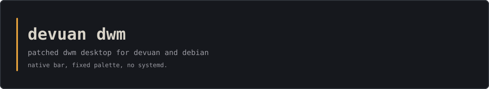

# dwm-setup

builds a patched dwm desktop for devuan 6 or debian 13 with the native dwm bar, st, dmenu, rofi and a fixed graphite amber palette.

[read the quick start](#quick-start)

| | |
| --- | --- |
| **build** | distro dwm, stterm and suckless-tools; slstatus and tabbed build locally from this repo. |
| **bar** | slstatus feeds dwm's own bar. no shell, qml or gpu process for the status text. |
| **palette** | graphite `#16181d` with amber `#e8a33d`. colors are never derived from a wallpaper. |
| **init** | openrc and sysvinit only. doas first, sudo as fallback. no systemctl. |

## What you're getting

- **dwm from the distro packages.** Window management uses the packaged dwm 6.x. This repo owns the supporting layer: slstatus, sxhkd, rofi, dunst, picom, scripts and a fixed Graphite Amber palette. The patched 6.8 source tree is not shipped here.
- **The native dwm bar, fed by slstatus.** WiFi, CPU, RAM, disk, battery and the clock, drawn as colored status2d blocks. It's just a root-window name that dwm renders; no shell, no QML, no GPU.
- **st is the default terminal.** `Super + Return` opens it, and the scratchpad uses it too. kitty is still installed and themed to match, for when you want tabs and richer config. The session wrapper points `KITTY_CONFIG_DIRECTORY` at the repo's kitty config, so this setup never touches a global `~/.config/kitty`. Built with scrollback, clipboard, and url/copyout: `Ctrl + Shift + l` picks a URL to open, `u` copies one, `o` copies a command's output (dmenu-driven), all through the bundled `st-urlhandler`/`st-copyout` scripts.
- **dmenu and rofi, both colored to match.** `Super + p` runs dmenu; rofi handles the app menu, the window switcher and the power menu.
- **dunst, picom, redshift, xfce4-power-manager, lxpolkit** — notifications, compositing, night light, power and battery, and a polkit agent, all started from `autostart.sh` and guarded so restarts don't duplicate them.
- **Login through LightDM** with a `dwm` session (`user-session=dwm`). The `dwm-session` wrapper exports the session-scoped env before dwm starts.

Because this is Devuan, the whole thing runs on OpenRC/sysvinit. There is no `systemctl` anywhere in the installer or the steps, and privilege escalation is **doas first, sudo as fallback** — never bare sudo.

## Quick start

You want a fairly fresh Devuan 6 or Debian 13 base, and a user that can escalate (doas or sudo). Then:

```bash
git clone https://github.com/SOSMLG/DevuanDwm.git
cd DevuanDwm
./install.sh
```

That single command, unattended:

1. Verifies the OS (Devuan 6 / Debian 13 base; Ubuntu is refused on purpose), updates package lists, and purges the distro `dwm` package so no stock build shadows ours in `/usr/local/bin`.
2. Installs the base packages — Xorg, picom, rofi, dunst, feh, lightdm + greeter, the Thunar stack, audio tools, fonts and build essentials. It does **not** run `apt upgrade`; you pick the upgrade moment, that's deliberate.
3. Enables services the OpenRC way: `avahi-daemon`, `acpid`, `lightdm` (and `bluetooth` if the hardware check found an adapter). One display manager only — lightdm owns the console.
4. Copies the whole `suckless/` tree to `~/.config/suckless/` (with a backup prompt if something's already there) and builds **dwm, slstatus, st, tabbed and dmenu** in place.
5. Wires up the login: `user-session=dwm`, the `dwm.desktop` XSession, the `dwm-session` wrapper in `/usr/local/bin`, a Thunar "Open Terminal Here" helper (kitty), and the `~/.xsessionrc` PATH snippet so `~/.local/bin` tools are findable from the WM.

Then reboot, pick `dwm` at the LightDM greeter, and press `Super + /` for the keybinding reference.

The installer only owns the base system. Once it's done, the app layers come from the step runner:

```bash
cd DevuanDwm
./install.sh --list              # what the phases contain
./install.sh --phase core,apps   # pick phases
./install.sh --only gaming,chat  # or individual steps
./install.sh --full              # everything, unattended
```

`./install.sh` asks Y/N per step, one password prompt up front (doas `persist` is primed and kept alive for the whole run), and logs everything to `~/.local/state/dwm-setup/last-run.log`. A reboot after `--full` is recommended — group membership from the first step needs a fresh login.

Re-running the config part without touching packages or services is exactly what `--only-config` is for, and it's the same flag you'd use on an unsupported distro, where you'd install dwm/st/dmenu by hand and build slstatus/tabbed afterward.

## Keybindings

The packaged dwm owns window management with its stock bindings. This repo owns the sxhkd layer for apps, media and system actions; sxhkd starts from `~/.config/suckless/scripts/autostart.sh`.

| Shortcut | Action |
|---|---|
| `Super + Space` | rofi app menu (drun) |
| `Super + b` | Firefox ESR |
| `Super + f` | Thunar |
| `Super + e` | VSCodium |
| `Super + g` | GIMP |
| `Super + d` | Vesktop (Discord) |
| `Super + o` | OBS |
| `Super + Shift + l` | Layout menu (rofi) |
| `Super + Shift + p` | Wallpaper picker (re-applies Graphite Amber) |
| `Super + Ctrl + r` | Restart slstatus |
| `Super + Shift + n` | Network connection editor (toggle) |
| `Super + F10` / `F11` / `F12`, `XF86Audio*` | Mute / volume down / volume up |
| `XF86MonBrightnessUp/Down` | Brightness (`xbacklight` ±10) |
| `Super + s` / `Shift + s` | Flameshot fullscreen / region |
| `Super + Escape` | Reload sxhkd |
| `Super + x` | Power menu (rofi, loginctl) |

The `help` script reads `sxhkdrc` and an optional `keybindings.txt` when present, so `Super + /` shows the custom layer without depending on a local dwm build. Pinned entries — the ones prefixed with `!` in the source — float to the top of their section.

**Changing a custom binding** means editing `~/.config/suckless/sxhkd/sxhkdrc`, then pressing `Super + Escape`. To change dwm's own keys, edit the packaged dwm configuration instead.

## The bar

slstatus writes one line of text — WiFi signal, CPU, RAM, disk, battery and a clock — into the root window name, and dwm renders it in its stock bar. It refreshes every second, which is plenty for a status line and nothing you'd notice in the CPU graph.

The `bar` script restarts slstatus cleanly; `Super + Ctrl + r` is the sxhkd shortcut. Bar toggling and tray behavior follow the packaged dwm defaults.

## The look: static Graphite Amber

There is one palette and it is not negotiable: canvas `#16181D`, amber accent `#E8A33D`, muted text `#9A9AA2`, warm light text `#D8D3C8`, JetBrainsMono Nerd Font throughout. dwm, st, slstatus, rofi, dunst and kitty all ship with these colors baked in, so even a bare install looks right before anything else runs.

The wallpaper picker (`wallpaper-theme`, `Super + Shift + p` with sxhkd, or just run the script) still exists, but it doesn't derive colors from the image — there's no extraction engine anymore, and that's the point. It picks one of the bundled graphite wallpapers (`suckless/wallpaper/`: graphite-amber, andromeda-2, black-leaves, cozy-red, fog-forest, night-dunes, drop more in and they appear in the dmenu list), then re-applies the same fixed palette:

- a marker-bracketed block in `~/.Xresources` for dwm and st colors, then `xrdb -load`;
- `rofi/colors.rasi`, the dunst `# THEME:` hex lines, and kitty's `current-theme.conf`;
- the wallpaper itself, persisted into `autostart.sh` so it survives logins;
- a dunst respawn, and a poke at dwm's `_DWM_RELOADCOLORS` atom so dwm recolors in place without re-execing — your tags and layouts stay put. The same live recolor is one signal away: `kill -USR1 <dwm-pid>`.

So the picker changes the picture, and the picture always matches the theme because both come from the same static set. No drift, no surprise pastels.

## Configuration

Local configs live under `~/.config/suckless/`, copied straight from the repo by `install.sh`. dwm, st and dmenu come from the distro packages and are not part of this tree.

```
~/.config/suckless/
├── slstatus/             # config.h — what the bar shows
├── tabbed/               # tabbed container source
├── rofi/                 # config.rasi, window.rasi, keybinds.rasi, power.rasi
│   └── colors.rasi       # palette, rewritten by wallpaper-theme
├── dunst/dunstrc         # notifications (THEME-marked hex lines)
├── picom/picom.conf      # compositor (xrender backend by default)
├── kitty/                # kitty.conf + current-theme.conf (session-scoped)
├── sxhkd/sxhkdrc         # app/media key layer (autostarted)
├── wallpaper/            # the bundled graphite set
└── scripts/              # autostart, bar, changevolume, dwm-session,
                          # dwm-layout-menu, gen-keybinds, help, network,
                          # power, wallpaper-theme, weather
```

Only the local source trees are rebuilt:

```bash
cd ~/.config/suckless/slstatus   # or tabbed
make && doas make install
```

The `weather` script is the rofi front-end for the bar's weather readout — type a city, or pick the rows that reset location and units. It keeps its state in two plain files (`weather-location`, `weather-units`) next to the configs.

## Step phases

`install.sh` discovers steps from `steps/##-*.sh`; the leading digit decides the phase. Every step declares its own description and default via the `# DEBSWAY_DESC:` / `# DEBSWAY_DEFAULT:` headers, which is exactly what `install.sh --list` prints:

| Phase | Step | Default | What it installs |
|---|---|---|---|
| core | 12-user-groups.sh | Y | Adds your user to input/video/render/plugdev + ensures a doas rule |
| core | 13-hardware.sh | Y | WiFi/Bluetooth/AMD GPU firmware, CPU microcode, fwupd, lm-sensors |
| core | 14-bluetooth.sh | Y | bluez, Blueman applet, A2DP audio (PipeWire or PulseAudio detected) |
| core | 15-codecs.sh | Y | ffmpeg, GStreamer plugins, DVD playback (libdvdcss) |
| core | 16-firefox.sh | Y | Firefox ESR + Betterfox hardening (policies.json, user.js) |
| core | 17-fonts.sh | Y | Noto + Font Awesome, JetBrainsMono Nerd Font download, fontconfig |
| core | 18-butterbash.sh | Y | ButterBash sane shell + aliases (bundled in `butterbash/`) |
| core | 19-fastfetch.sh | Y | fastfetch + curated config (bundled under `configs/fastfetch/`) |
| desktop | 20-shell-tools.sh | Y | autorandr display profiles, brightnessctl, playerctl, iio-sensor-proxy |
| engineering | 30-eng-math.sh | Y | Octave, Jupyter/IPython, SciPy stack, python-control venv, dev toolchain |
| engineering | 31-eng-eda.sh | Y | Scilab/Xcos, Qucs, KiCad |
| engineering | 32-eng-matlab.sh | Y | matlab-support + `matlab-install` helper for a MathWorks .deb |
| apps | 40-desktop-apps.sh | Y | Flatpak/CUPS/firewall, mpv, zathura, qbittorrent, TLP + battery cap, btop/eza/bat |
| apps | 41-timeshift.sh | Y | Timeshift snapshots (cron-based, no systemd timers) |
| apps | 42-opencode-agent.sh | Y | OpenCode CLI via npm, PATH, repo AGENTS.md → ~/.config/opencode/ |
| apps | 43-office-mail.sh | Y | LibreOffice Writer/Calc, Thunderbird, KeePassXC, gnome-keyring |
| apps | 44-media.sh | Y | OBS, Kdenlive, GIMP (+ optional PhotoGIMP layout) |
| apps | 45-gaming.sh | Y | Steam (i386 arch added up front), Wine, Heroic via Flatpak |
| apps | 46-chat.sh | Y | Vesktop (Discord) + Telegram, both Flatpak |
| apps | 47-editors.sh | Y | VSCodium (apt repo) + Neovim + LazyVim bootstrap |
| utils | 50-maintenance.sh | N | apt autoclean/autoremove, dead `~/.local/bin` symlink tidy, optional full-upgrade |
| utils | 51-backup.sh | N | Timestamped `~/.config`/dotfiles backup to `dwm-setup-config-backup-*.tar.gz` (+ list/restore) |
| utils | 52-skel-export.sh | N | Copy per-user defaults (suckless configs, fastfetch, ButterBash, fonts) into `/etc/skel` |

Phase filters: `--phase core,desktop,engineering,apps,utils` (or a subset). `--only` takes names or numbers and matches partial names (`--only gaming` finds `45-gaming.sh`). `--yes` answers every prompt with its default; `--full` is `--yes` with every default forced to Y; `DEBSWAY_ASSUME_YES=1` does the same from the environment. `--verify` closes the loop by running `verify.sh` — a read-only audit that checks group membership, the packaged dwm/st/dmenu commands, the locally built slstatus/tabbed binaries, the Graphite Amber hex spot-checks in dunst/rofi, OpenRC, the lightdm session and the optional app packages.

The engineering trio is worth calling out: 30 covers the MathWorks-free side (Octave, notebooks, the SciPy stack and a small `~/.local/venv/eng` that holds python-control so it never touches apt), 31 brings in the heavy EDA tools, and 32 doesn't install Matlab itself — MathWorks needs your account for that — it installs `matlab-support` and drops a `matlab-install` helper in `~/.local/bin` that verifies and attaches a downloaded MathWorks `.deb` with `dpkg -i`.

## Packages, grouped

The base install (from `install.sh`) pulls, roughly:

- **X + display:** `xorg` `xorg-dev`, `lightdm` + `lightdm-gtk-greeter`, `picom`, `feh`, `xsettingsd`, `nwg-look`, `xbacklight`, `xinput`
- **Suckless:** `dwm`, `stterm`, `suckless-tools` from the distro; `slstatus` and `tabbed` built locally
- **Launchers & UI:** `rofi`, `dunst`, `dmenu`-adjacent helpers, `flameshot`, `qimgv`, `lxpolkit`
- **Files:** `thunar` + `thunar-archive-plugin` + `thunar-volman`, `gvfs-backends`/`gvfs-fuse`, `dialog` `mtools` `smbclient` `cifs-utils` `unzip`
- **Audio:** `pavucontrol` `pulsemixer` `pamixer` `pipewire-audio` `pulseaudio-utils`
- **System:** `avahi-daemon` `acpi` `acpid` `xfce4-power-manager`, `redshift` `brightnessctl` `sound-theme-freedesktop`, `network-manager-gnome`, `dbus-x11`, `libnotify-bin`
- **Input extras:** `sxhkd` `xbindkeys` `xvkbd` `xdotool`
- **Terminals & tools:** `firefox-esr`, `kitty`, `eza`
- **Fonts:** `fonts-recommended` `fonts-font-awesome` `fonts-terminus`
- **Build deps:** `build-essential` `cmake` `meson` `ninja-build` `curl` `pkg-config` `wget`

Bluetooth firmware follows the hardware: if the kernel exposes an adapter, `bluez` and `libspa-0.2-bluetooth` join the base install; the applet and A2DP setup are the 14 step's job. Everything heavier is step-scoped, so a base install stays lean — the engineering and app phases are opt-in by design.

## Troubleshooting, quick hits

The longer write-ups live in [`docs/troubleshooting.md`](docs/troubleshooting.md). The two-minute versions:

- **Bar gone or weird:** `bar restart`, or `Super + Ctrl + r` with sxhkd. slstatus is a pgrep-guarded daemon in `autostart.sh`; if it died, that's the bounce.
- **Nothing you type in sxhkd fires:** check `pgrep -ax sxhkd`; `autostart.sh` launches it. Reload with `Super + Escape` after editing `sxhkdrc`.
- **A `dwm` package respawned:** that is expected — the packaged dwm is the one this setup uses. The local rebuild path no longer applies.
- **Login loop or black screen:** check `~/.xsession-errors` first — it's the honest record of what the session did. `dwm-session` execs the packaged dwm, so startup errors show up there.
- **`~/.local/bin` tools invisible from the WM:** LightDM sessions read `~/.xsessionrc`, not `~/.profile`. `install.sh` writes the PATH snippet; if you added the tool later, the snippet is idempotent and safe to re-run.
- **Mouse stutter on NVIDIA:** picom ships with `backend = "xrender"` on purpose (it works everywhere). On the proprietary driver, switch it to `glx` in `picom.conf` and restart picom — but leave it alone on Intel/VMs where glx can be worse.

## License

GPL-2.0 — the whole tree, suckless builds and scripts alike. See [LICENSE](LICENSE).

## Where this lives

The fork is on GitHub: [SOSMLG/DevuanDwm](https://github.com/SOSMLG/DevuanDwm). The upstream this was cut from is justaguy.dev/drew/dwm-setup, kept around purely as history. There's no wiki; the README, `QUICKSTART.md`, `CHANGELOG.md` and `docs/troubleshooting.md` are the whole story.

## Related repos

- [DebianSway](https://github.com/SOSMLG/DebianSway): Sway on Debian/Devuan.
- [DevuanSway](https://github.com/SOSMLG/DevuanSway): Sway on Devuan with OpenRC.
- [Devuan-Kde](https://github.com/SOSMLG/Devuan-Kde): KDE Plasma on Devuan.
- [devuan-cinnamon-setup](https://github.com/SOSMLG/devuan-cinnamon-setup): Cinnamon on Devuan.
- [XfceMlg](https://github.com/SOSMLG/XfceMlg): XFCE desktop toolkit.

## Repository standard

This repo follows the SOSMLG standard: [contributing](CONTRIBUTING.md), [security](SECURITY.md), [changelog](CHANGELOG.md). Local workflow: [English guide](https://github.com/SOSMLG/.github/blob/main/docs/GIT_GUIDE.md) / [Arabic guide](https://github.com/SOSMLG/.github/blob/main/docs/GIT_GUIDE.ar.md). Visual standard: [theme](https://github.com/SOSMLG/.github/blob/main/docs/THEME.md) / [الطابع البصري](https://github.com/SOSMLG/.github/blob/main/docs/THEME.ar.md).
